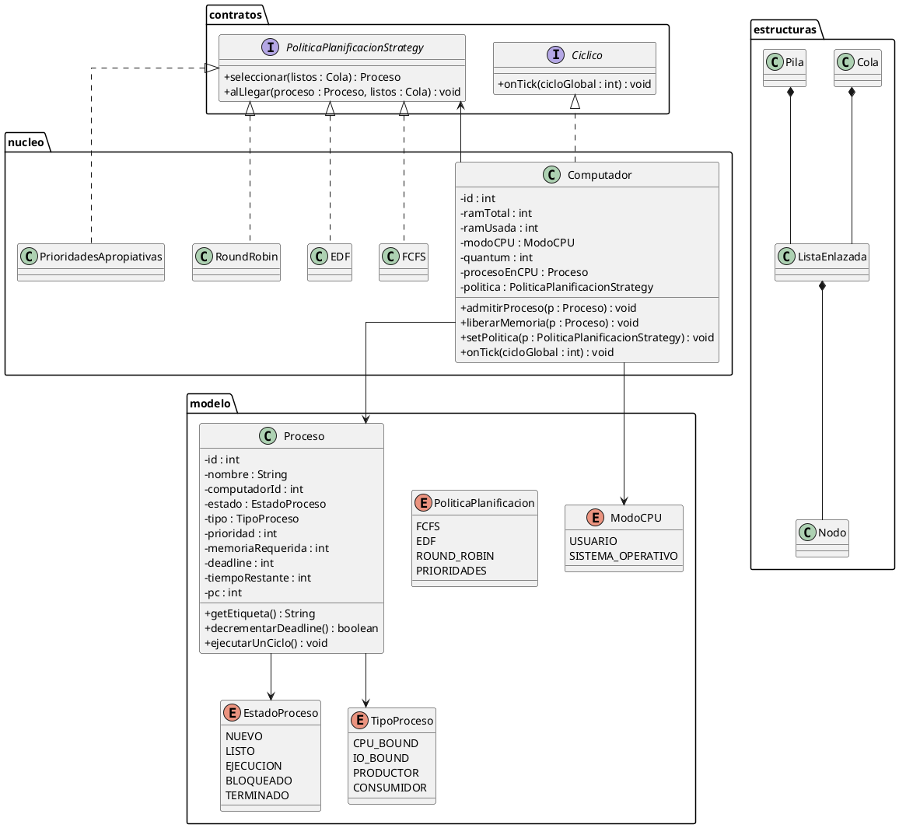
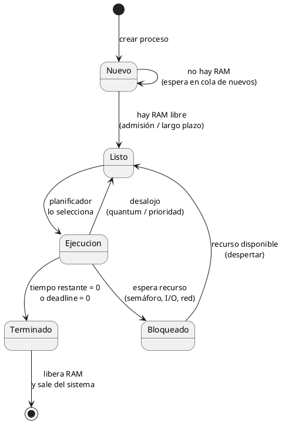

# Proyecto 1: ÁvilaOS
## Sistemas Operativos — Trimestre 2627-1

**Asignatura:** Sistemas Operativos  
**Proyecto:** Diseño de un Sistema Operativo Distribuido  
**Repositorio:** https://github.com/Stefano-dmm/AvilaOs---Sis.-Op.git  

**Integrantes:**  
- Stefano … (completar apellido / cédula / sección)  
- … (integrante 2)  
- … (integrante 3)  

---

## 1. Introducción

ÁvilaOS es un simulador de un sistema operativo distribuido sencillo pensado para coordinar un pequeño clúster de computadores. Cada máquina tiene su propia CPU, memoria principal (RAM) y núcleo con planificador y colas, todos sincronizados por un reloj global. El sistema admite procesos monohilo, gestiona la memoria sin memoria virtual en esta versión, y permite que productores y consumidores se comuniquen mediante buffers de capacidad limitada sincronizados con semáforos, con acceso local o remoto.

El objetivo no es construir un sistema operativo real, sino modelar con fidelidad cómo colaborarían esas máquinas y cómo el núcleo decide quién se ejecuta, quién se bloquea y quién despierta.

---

## 2. Enumeraciones

El sistema utiliza enumeraciones para representar conjuntos fijos de valores:

- **EstadoProceso:** Nuevo, Listo, Ejecución, Bloqueado y Terminado. Indica en qué etapa está el proceso.
- **ModoCPU:** Usuario o Sistema Operativo. Muestra si la CPU corre un programa o trabajo del núcleo.
- **TipoProceso:** CPU bound, I/O bound, productor o consumidor.
- **PoliticaPlanificacion:** FCFS, EDF, Round Robin y Prioridades. Identifica la política de cada computador.

---

## 3. Interfaces

- **PoliticaPlanificacionStrategy:** define cómo se elige el siguiente proceso de la cola de listos y cómo se inserta un proceso al llegar. Así se pueden agregar políticas nuevas sin rehacer el planificador.
- **Ciclico:** define qué partes del sistema avanzan en cada ciclo del reloj global. Cada computador avanza un ciclo cuando marca el reloj.

---

## 4. Estructuras de datos propias

Como no se pueden usar las colecciones del framework de Java, el núcleo se apoya en:

- **Nodo:** unidad básica de enlace.
- **ListaEnlazada:** almacenamiento genérico.
- **Cola:** disciplina FIFO para nuevos, listos, bloqueados y terminados.
- **Pila:** disciplina LIFO para operaciones del núcleo que la requieran.

---

## 5. Clases y métodos principales

### 5.1 Proceso (PCB)

Guarda la información del proceso: ID único global, nombre, computador donde corre, estado, tipo, prioridad, memoria, deadline, tiempo restante y contador de programa (PC).

Métodos relevantes:
- cambio de estado
- `decrementarDeadline()`
- `ejecutarUnCiclo()`
- `getEtiqueta()`

### 5.2 Computador

Representa una máquina del clúster (CPU, memoria y colas). Se puede crear más de una con la misma clase.

Métodos relevantes:
- `admitirProceso`
- `liberarMemoria`
- `setPolitica`
- `onTick` (avanzar un ciclo)

### 5.3 Planificador de largo plazo

Decide si un proceso pasa de Nuevo a Listo según haya memoria libre. Si no hay espacio, espera en la cola de nuevos. Cuando un proceso termina, se libera memoria y se vuelve a revisar esa cola.

### 5.4 Planificador de corto plazo

Elige qué proceso usa la CPU según la política configurada (por llegada, deadline, quantum o prioridad).

### 5.5 Políticas (FCFS, EDF, Round Robin y Prioridades)

Cada una implementa la interfaz de planificación con un criterio distinto:
- **FCFS:** orden de llegada.
- **EDF:** menor deadline.
- **Round Robin:** rotación con quantum configurable.
- **Prioridades:** mayor prioridad; puede apropiar la CPU.

### 5.6 Cluster / ÁvilaOS

Agrupa los computadores y asigna cada proceso a uno de ellos (manual o automática). Una vez asignado, el proceso no cambia de máquina.

### 5.7 Buffer y semáforos (módulo de sincronización)

Buffers de capacidad limitada alojados en un computador anfitrión. La sincronización usa el esquema productor-consumidor con semáforos (vacíos, llenos y mutex). El acceso puede ser local o remoto (con latencia de red).

### 5.8 Reloj global

Marca el ritmo de la simulación. En cada ciclo, todos los computadores avanzan exactamente un tick.

### 5.9 Interfaz gráfica

Observa el estado del sistema (no contiene la lógica del SO): proceso en CPU, colas, memoria, buffers, política y log de eventos.

---

## 6. Diagrama UML de clases

> Insertar aquí la imagen exportada desde PlantUML (`uml_clases.puml`).

---

## 7. Diagrama UML de estados del proceso

> Insertar aquí la imagen exportada desde PlantUML (`uml_estados.puml`).

---

## 8. Comportamiento del sistema con cada política

Con **FCFS**, los procesos se atienden en el orden en que llegan a la cola de listos. Es predecible y simple, pero un proceso largo puede retrasar a otros con deadline cercano, por lo que el cumplimiento de tiempos límite suele ser menor cuando la carga es alta.

Con **EDF**, se prioriza el proceso con deadline más próximo. En general mejora el porcentaje de procesos que terminan a tiempo frente a FCFS, aunque si muchos comparten deadlines parecidos la ventaja se reduce y el orden puede volverse más inestable ante llegadas frecuentes.

Con **Round Robin**, el quantum reparte la CPU de forma más equitativa: ningún proceso monopoliza el procesador por mucho tiempo. El tiempo de respuesta promedio suele mejorar para procesos cortos, pero si el quantum es muy pequeño aumenta el cambio de contexto; si es muy grande, se parece a FCFS.

Con **Prioridades apropiativas**, los procesos urgentes (mayor prioridad) pueden desalojar al que está en CPU. Eso favorece tareas críticas, pero si siempre entran procesos de alta prioridad, los de baja pueden esperar demasiado (inanición), lo que afecta la equidad del sistema.

El **deadline en 0** termina el proceso aunque le quede trabajo. Eso hace visible qué política protege mejor los plazos: EDF y prioridades bien asignadas suelen comportarse mejor que FCFS en ese indicador.

Al **cambiar la política en caliente**, el computador no reinicia las colas: solo cambia el criterio de selección. El efecto se nota en los siguientes ciclos, cuando el orden de atención deja de seguir la política anterior.

---

## 9. Productores y consumidores locales y remotos

Cuando productor y consumidor están en el **mismo computador** que el buffer, el acceso es local: no pagan latencia de red y el bloqueo en semáforos depende solo de buffer lleno, vacío o exclusión mutua.

Cuando el acceso es **remoto**, cada operación sobre el buffer suma ciclos de latencia. Los procesos pasan más tiempo bloqueados, baja la utilización útil de la CPU de su máquina y el throughput del productor-consumidor suele ser menor que en el caso local, aunque la sincronización con semáforos siga siendo la misma.

---

## 10. Notas de implementación (estado actual)

Al momento de redactar este borrador:

- Implementado en código: enums, interfaces, estructuras propias, PCB (`Proceso`) y prueba básica.
- Pendiente en código: `Computador`, políticas completas, reloj, buffers/semáforos, GUI y métricas.

El diseño descrito en este informe corresponde a la arquitectura objetivo del Proyecto 1 y se irá reflejando en el repositorio a medida que avance el desarrollo.

---

## Referencias

- Enunciado Proyecto 1. Sistemas Operativos 2627-1  
- Stallings, W. — sincronización productor-consumidor con buffer acotado (Anexo del enunciado)
