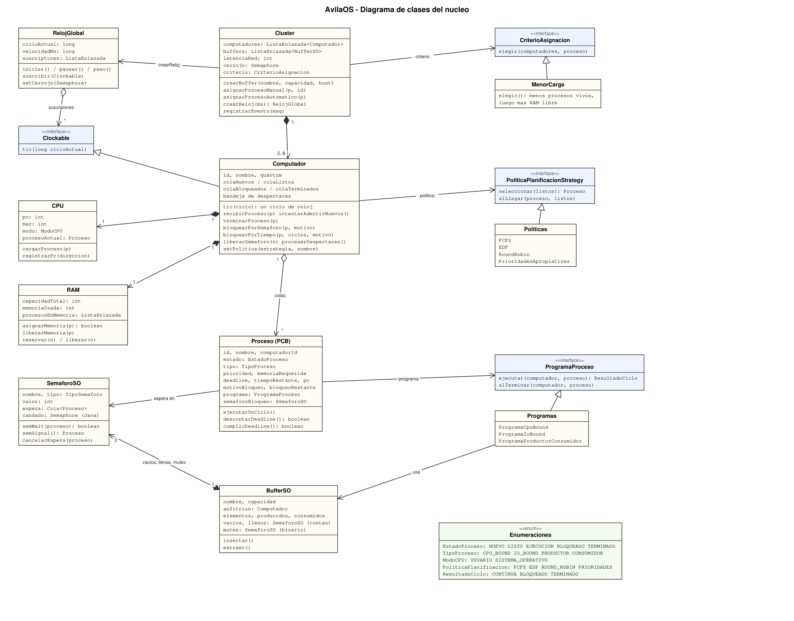
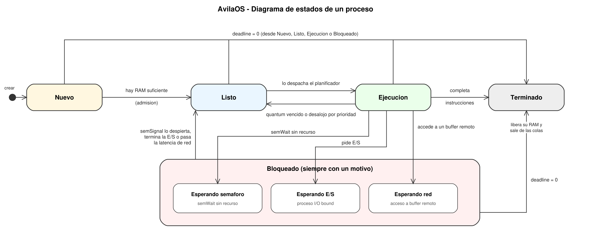

# Proyecto 1: ÁvilaOS
## Diseño de un Sistema Operativo Distribuido

**Asignatura:** Sistemas Operativos

**Trimestre:** 2627-1

**Profesor:** García

**Integrantes:**

- Stefano Di Michelangelo — V-29678557
- Jesús Bethencourt — V-30906782
- Jesús Fernández — V-29965948

**Repositorio:** https://github.com/Stefano-dmm/AvilaOs---Sis.-Op

Caracas, octubre de 2026

\newpage

## 1. Introducción

ÁvilaOS es un simulador de un sistema operativo distribuido sencillo. Es un clúster de 2 a 8 computadores; cada uno tiene su CPU, su RAM y su propio núcleo con planificador y colas, y todos avanzan al ritmo de un reloj global. Los procesos tienen un solo hilo y pueden ser CPU bound, I/O bound, productor o consumidor. Los productores y consumidores se comunican con buffers de capacidad limitada, sincronizados con semáforos, de forma local o remota (con latencia de red).

Está hecho en Java 21 con NetBeans y Swing. No usa librerías externas ni colecciones de `java.util`: las listas, colas y pilas son propias.

## 2. Cómo está organizado

El código está en capas:

- **Hardware** (`hardware`): `RelojGlobal`, `Clockable`, `CPU` y `RAM`.
- **Núcleo** (`nucleo`): `Computador` (admisión, planificador, colas, bloqueos y deadlines) y `Cluster` (computadores, buffers, latencia de red y balanceo).
- **Sincronización** (`sincronizacion`): `SemaforoSO` y `BufferSO`.
- **Modelo** (`modelo`): `Proceso` (el PCB) y los enums.
- **Interfaz, métricas y configuración** (`gui`, `metricas`, `config`): solo observan el sistema, no tienen lógica del sistema operativo.

**Hilos y exclusión mutua.** El reloj global es un hilo y cada computador corre en su propio hilo. En cada ciclo el reloj avisa a todos los computadores y espera a que todos terminen antes de pasar al siguiente (una barrera hecha con `Semaphore`). Mientras dura el ciclo, el reloj tiene tomado un cerrojo (`Cluster.cerrojo`) que la interfaz también usa para leer o cambiar cosas, así nunca se ve un ciclo a medias. Cada `SemaforoSO`, cada `BufferSO` y la bandeja de despertares de cada computador tienen su propio `Semaphore` de Java. Cuando un proceso despierta a otro que está en otro computador, no toca las colas de ese computador: le deja un aviso en su bandeja y el otro lo procesa al empezar su siguiente ciclo. Qué protege cada semáforo está explicado en `docs/Guia_del_codigo.md`.

## 3. Enumeraciones e interfaces

**Enums** (valores fijos del sistema):

- `EstadoProceso`: Nuevo, Listo, Ejecución, Bloqueado y Terminado.
- `TipoProceso`: CPU bound, I/O bound, productor y consumidor.
- `ModoCPU`: usuario o sistema operativo.
- `PoliticaPlanificacion`: FCFS, EDF, Round Robin y Prioridades.
- `ResultadoCiclo`, `TipoSemaforo` y `PasoComunicacion`: apoyan a los programas de proceso y a los semáforos.

**Interfaces** (lo que puede cambiar sin tocar el núcleo):

- `PoliticaPlanificacionStrategy`: cómo se ordena la cola de listos y quién pasa a la CPU. Permite cambiar la política en ejecución y agregar una nueva sin modificar el planificador.
- `Clockable`: todo lo que reacciona al reloj (el `Computador`) recibe un `tic` por ciclo.
- `ProgramaProceso`: el "código" de cada tipo de proceso (CPU, E/S, productor-consumidor).
- `CriterioAsignacion`: cómo se reparten los procesos entre computadores cuando el usuario no elige.

## 4. Estructuras de datos propias

`Nodo` y `ListaEnlazada` son la base: cada nodo guarda un dato y apunta al siguiente. `Cola` (FIFO) se usa para las colas de nuevos, listos, bloqueados y terminados y para la cola de espera de cada semáforo. `Pila` (LIFO) está hecha porque el enunciado la pide, pero el núcleo no la necesita. Las demás librerías usadas son solo de Java: Swing para la interfaz, `Semaphore` para la exclusión mutua y `java.io` para el CSV. El gráfico se dibuja con Java2D.

## 5. Clases y métodos más importantes

- **`Proceso` (PCB):** ID único en todo el sistema, nombre, computador, estado, tipo, prioridad, memoria, deadline, tiempo restante y contador de programa (PC). Sus métodos principales son `ejecutarUnCiclo()`, `descontarDeadline()` y `cumplioDeadline()`.
- **`Computador`:** es la unidad reutilizable; agregar un computador es crear otra instancia. Su método `tic()` hace un ciclo en este orden: procesa los despertares, avanza los bloqueos por tiempo, despacha según la política, ejecuta una instrucción del proceso en CPU y baja el deadline de los procesos vivos. También tiene `recibirProceso()` e `intentarAdmitirNuevos()` (admisión de largo plazo, solo si hay RAM), `terminarProceso()`, `bloquearPorSemaforo()`, `bloquearPorTiempo()` y `setPolitica()`.
- **`Cluster`:** guarda los computadores y los buffers, asigna procesos (a mano o automático), crea el reloj y entrega los mensajes al log.
- **`SemaforoSO`:** semáforo propio de conteo o binario. `semWait()` deja al proceso en la cola del semáforo si no hay unidades y `semSignal()` devuelve al proceso que hay que despertar. Bloquea procesos, no hilos de Java.
- **`BufferSO`:** buffer acotado con tres semáforos (`vacios`, `llenos` y `mutex`). Ocupa RAM en su computador anfitrión.
- **Programas:** `ProgramaCpuBound` ejecuta una instrucción por ciclo; `ProgramaIoBound` pide una E/S después de cada ráfaga de CPU y se bloquea mientras dura; `ProgramaProductorConsumidor` ejecuta el protocolo con semáforos.

## 6. Procesos, estados y deadline

Los estados son Nuevo, Listo, Ejecución, Bloqueado y Terminado. Un proceso Bloqueado siempre tiene un motivo, que se ve en la interfaz. Los separé en tres porque cada uno termina distinto:

- **Esperando semáforo:** `semWait` sin unidades (buffer lleno, vacío o región crítica ocupada). Termina cuando otro proceso hace `semSignal`. Es el único que cuenta para el tiempo bloqueado en semáforos.
- **Esperando E/S:** un proceso I/O bound terminó su ráfaga. Termina cuando pasan los ciclos de la E/S.
- **Esperando red:** acceso a un buffer de otro computador. Termina cuando pasa la latencia de red.

**Deadline.** Baja un ciclo por cada ciclo de reloj para todo proceso vivo (en CPU, listo, bloqueado o esperando memoria). Al llegar a 0 el proceso se termina y suelta lo que tenga: su RAM, su lugar en la cola de un semáforo y, si estaba a mitad del protocolo, el mutex o el hueco que hubiera tomado, para no dejar el buffer atascado.

## 7. Planificación y asignación

Cada computador tiene su política, que se puede cambiar en ejecución sin afectar a los demás:

- **FCFS:** el primero que llegó. No es apropiativa.
- **EDF:** el de deadline más cercano. No es apropiativa.
- **Round Robin:** por turnos, con quantum configurable (también en ejecución).
- **Prioridades apropiativas:** la mayor prioridad; si llega o despierta una mayor, le quita la CPU a la actual.

Al cambiar de proceso, el log muestra el cambio de contexto: qué proceso se guarda en su PCB con qué PC y cuál se carga con su PC restaurado.

**Asignación.** El usuario elige el computador o deja "Automático". El criterio automático manda el proceso al computador con menos procesos vivos; si empatan, al que tiene más RAM libre, y luego al de menor id. Se descartan los computadores cuya RAM nunca alcanzaría para el proceso. Lo elegí porque no se sabe cuánto va a durar cada proceso y no hay migración, así que lo mejor es mantener las colas parejas. Su límite es que no distingue procesos largos de cortos.

## 8. Memoria y productor-consumidor

**Memoria.** Cada computador tiene una RAM configurable y cada proceso declara cuánta necesita. Un proceso solo pasa de Nuevo a Listo si hay memoria; si no, espera en la cola de nuevos. Al terminar un proceso se libera su memoria y se revisa si algún nuevo ya cabe. Los buffers también ocupan RAM en su computador anfitrión.

**Productor-consumidor.** Cada buffer usa el algoritmo clásico con tres semáforos:

```
productor:            consumidor:
  producir              semWait(llenos)
  semWait(vacios)       semWait(mutex)
  semWait(mutex)        extraer
  insertar              semSignal(mutex)
  semSignal(mutex)      semSignal(vacios)
  semSignal(llenos)     consumir
```

- El orden de los `semWait` importa: si el productor tomara primero el `mutex` y luego `vacios`, con el buffer lleno se quedaría con el mutex y nadie podría consumir (interbloqueo).
- Cada `semWait`, `semSignal`, inserción o extracción cuenta como una instrucción en modo sistema operativo; producir y consumir son en modo usuario.
- Puede haber varios productores y consumidores, en el mismo computador del buffer o en otros.
- Si el buffer está en otro computador, antes de cada acceso el proceso se bloquea tantos ciclos como la latencia de red.
- Cuando un `semWait` no puede seguir, el proceso pasa a Bloqueado, entra a la cola del semáforo y la CPU atiende a otro.

## 9. Interfaz, configuración y métricas

- **Configuración inicial:** duración del ciclo, latencia de red, número de computadores y, para cada uno, RAM, política y quantum. Se puede guardar y cargar en un archivo CSV (también los buffers y procesos iniciales).
- **Crear procesos y buffers** en cualquier momento. Pide solo los campos del tipo elegido y el computador puede ser "Automático".
- **Una vista por computador:** proceso en CPU con su PC, MAR, prioridad y deadline; si corre el sistema operativo o un programa de usuario; las colas de nuevos, listos, bloqueados (con el motivo) y terminados con los datos del PCB; la RAM y el selector de política y quantum.
- **Global:** número de ciclo, botones iniciar, pausar y paso, duración del ciclo, estado de los buffers (elementos, semáforos y procesos bloqueados) y un log de eventos.
- Todos los campos validan tipo y rango sin detener la simulación, y un archivo inválido se rechaza diciendo en qué línea está el error.

**Métricas** (por computador y del sistema): throughput (procesos completados por ciclo), utilización de la CPU, tiempo de respuesta (de la llegada al primer despacho), tiempo de espera (ciclos en la cola de listos), tasa de éxito (deadlines cumplidos) y equidad (índice de Jain). Para productor-consumidor: elementos producidos y consumidos por buffer y tiempo promedio bloqueado en semáforos. Un gráfico con selector dibuja cualquiera de las cuatro principales contra el tiempo, una línea por computador y otra para el sistema.

\newpage

## 10. Diagramas UML





## 11. Resultados y conclusiones

Los experimentos son deterministas y se repiten con `avilaos.pruebas.ExperimentoPoliticas` (resultados completos en `docs/resultados_experimentos.md`).

### 11.1 Las cuatro políticas

Un computador y 8 procesos de CPU (de 8, 3, 6, 2, 5, 4, 7 y 1 instrucciones) que llegan entre los ciclos 0 y 5, con prioridades y deadlines distintos. Round Robin con quantum 3.

| Política | Respuesta prom. | Cumplimiento | Equidad | Cambios de proceso |
|---|---|---|---|---|
| FCFS | 8.80 | 50 % (4 de 8) | 0.38 | 0 |
| EDF | 9.63 | 100 % (8 de 8) | 0.75 | 0 |
| Round Robin | 7.00 | 63 % (5 de 8) | 0.65 | 5 |
| Prioridades | 9.50 | 75 % (6 de 8) | 0.65 | 2 |

- **FCFS** es la más simple pero la peor con deadlines: un proceso corto y urgente espera detrás de uno largo. Venció P2, P4, P6 y P8.
- **EDF** cumplió todos porque esta carga es factible: atiende primero lo urgente. A cambio no da el mejor tiempo de respuesta.
- **Round Robin** da el mejor tiempo de respuesta (7.00) porque todos reciben la CPU enseguida, pero no mira deadlines y dejó vencer a P4, P6 y P8.
- **Prioridades** atiende primero lo importante pero deja vencer a los de baja prioridad (P2 y P5): la prioridad y la urgencia no siempre coinciden.

Con deadlines ajustados conviene EDF; en un sistema interactivo sin deadlines, Round Robin.

### 11.2 El quantum de Round Robin

Un quantum pequeño mejora la respuesta (3.14 con quantum 1 frente a 7.00 con quantum 3) pero hace muchos más cambios de proceso (25 frente a 5). Con un quantum muy grande se comporta igual que FCFS: con quantum 8 los resultados fueron idénticos.

### 11.3 Productor y consumidor, local y remoto

Un productor y un consumidor de 12 elementos con un buffer de capacidad 2. En el caso local los dos están en el computador del buffer; en el remoto, el consumidor está en otro.

| Caso | Latencia | Terminan en el ciclo | Bloqueo en semáforos (prom.) |
|---|---|---|---|
| Local | — | 144 | 20.50 |
| Remoto | 0 | 76 | 2.00 |
| Remoto | 2 | 112 | 18.00 |
| Remoto | 5 | 148 | 34.50 |
| Remoto | 10 | 208 | 62.00 |

Con un solo computador los dos procesos se reparten una CPU. En dos computadores trabajan a la vez y el tiempo casi se reduce a la mitad (76 ciclos con latencia 0). Pero cada acceso remoto cuesta la latencia, así que a medida que crece, la ventaja desaparece: con latencia 5 el remoto ya es más lento que el local (148 frente a 144) y con 10 es mucho peor (208), y los procesos pasan más tiempo bloqueados en semáforos. Poner productor y consumidor en computadores distintos solo conviene si la latencia es pequeña frente al trabajo por elemento.

Un buffer más grande no cambia cuándo terminan (el trabajo es de CPU), pero baja mucho el tiempo bloqueado en semáforos: de 44.5 ciclos con capacidad 1 a 4.5 con capacidad 8.

### 11.4 Lo que esperábamos y lo que se midió

En el diseño inicial supusimos cómo se comportaría cada política. Los experimentos lo confirmaron casi todo: FCFS cumple menos deadlines, EDF más, Round Robin mejora la respuesta y prioridades puede dejar sin CPU a las de baja prioridad. Lo único que no salió como pensábamos fue lo remoto: no siempre es más lento que lo local, depende de la latencia.

## 12. Cómo trabajamos, pruebas y límites

**Trabajo.** Dividimos el proyecto en tres módulos (núcleo y planificación; hardware, reloj y sincronización; interfaz, configuración, métricas e informe). Usamos GitHub con la rama `develop`, ramas por funcionalidad y Pull Requests, commits pequeños con mensajes descriptivos, y fuimos de lo simple a lo complejo: un computador, luego semáforos y buffer local, luego remoto y varios computadores, y al final métricas e informe.

**Calidad y fiabilidad.** Hay 382 pruebas automáticas (sin librerías externas) con valores calculados a mano, incluyendo 30 repeticiones de simulaciones con hilos reales para detectar carreras. También se probaron casos borde: buffers que no caben en la RAM, procesos que mueren a mitad del protocolo, latencia 0 y alta, y cambios de política y de quantum en ejecución. El código está comentado con Javadoc.

**Límites.** EDF no es apropiativa (un proceso con deadline más cercano espera a que termine el que ejecuta). El balanceo no distingue procesos largos de cortos. Los nombres no pueden llevar comas por el formato CSV.

**Cómo ejecutar.** Abrir el proyecto en NetBeans (Java 21 o más) y ejecutarlo; la clase principal es `avilaos.gui.AvilaOSGui`. Las pruebas se corren con `avilaos.pruebas.EjecutarPruebas`.
